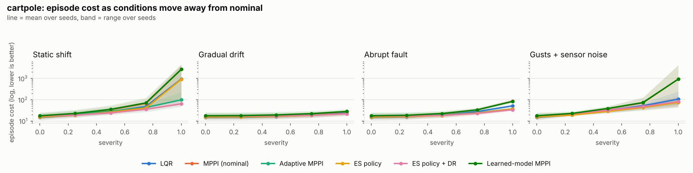

# control-sandbox

so the question is: **what happens to a controller when the real world stops matching its model?**

the payload gets heavier. a motor wears out. something breaks mid-flight. a gust hits. this repo
throws all of that at a bunch of different controllers and watches who copes and who falls over.

the lineup: good old LQR, sampling-based MPC (MPPI), MPPI that figures out the physics as it goes,
a model-free policy trained with evolution strategies, and MPPI planning with a learned dynamics model.
every result is a **robustness curve**, aka how performance degrades as conditions drift further
from "normal."

it all runs on a laptop CPU with just NumPy and SciPy. no GPU, no simulator license, no hardware.



## tl;dr results

5 seeds per point, 300-step episodes (6 seconds of sim time). full curves for every severity
live in [`results/`](results/). the tables below are the meanest setting, **severity 1.0**.
numbers are mean episode cost (lower = better), and the % in brackets is how many episodes
didn't crash.

**cart-pole** (pole 4x heavier and 1.5x longer, more friction, motor at 60% strength, plus a 1.5 N bias)

| Controller | Static shift | Gradual drift | Abrupt fault | Gusts + sensor noise |
| --- | --- | --- | --- | --- |
| LQR | 936 (80%) | 24 (100%) | 51 (100%) | 106 (100%) |
| MPPI (nominal) | 2,661 (40%) | 27 (100%) | 85 (100%) | 922 (80%) |
| Adaptive MPPI | 98 (100%) | 22 (100%) | 37 (100%) | 78 (100%) |
| ES policy | 908 (80%) | 22 (100%) | 37 (100%) | 74 (100%) |
| ES policy + DR | **64 (100%)** | 22 (100%) | **34 (100%)** | 81 (100%) |
| Learned-model MPPI | 2,644 (40%) | 28 (100%) | 83 (100%) | 925 (80%) |

**planar quadrotor** (25% heavier payload, right motor down to 80%)

| Controller | Static shift | Gradual drift | Abrupt fault | Gusts + sensor noise |
| --- | --- | --- | --- | --- |
| LQR | 212 (100%) | 42 (100%) | 87 (100%) | 131 (100%) |
| MPPI (nominal) | 535 (100%) | 59 (100%) | 290 (100%) | 149 (100%) |
| Adaptive MPPI | 98 (100%) | 28 (100%) | 77 (100%) | **111 (100%)** |
| ES policy | 125 (100%) | 32 (100%) | 61 (100%) | 118 (100%) |
| ES policy + DR | **76 (100%)** | 28 (100%) | **51 (100%)** | 133 (100%) |
| Learned-model MPPI | 571 (100%) | 60 (100%) | 339 (100%) | 155 (100%) |

what i took away from this:

- **only two things never crash: adapting on the fly, or training for chaos.** adaptive MPPI
  (a particle filter feeding live parameter guesses to the planner) and the policy trained with
  domain randomization are the only ones that survive every cart-pole episode at severity 1.
  anything that trusts one fixed model, learned or not, falls apart somewhere between 0.75 and 1.
- **they bounce back differently.** after the quadrotor's motor fault, the domain-randomized policy
  is back on target in about 0.3 s. adaptive MPPI takes about 3 s because it has to figure out
  what broke first. LQR and nominal MPPI never really get back; they just hover off to one side forever.
- **a fancier planner doesn't save you from a wrong model.** nominal MPPI is a better optimizer
  than LQR, but it plans very confidently with bad physics and ends up doing worse than LQR under
  every kind of shift.
- **a learned model is only as good as its data.** learned-model MPPI was trained on normal
  conditions and basically behaves like nominal MPPI. the sister repo
  [`dynamics-learning`](https://github.com/<your-username>/dynamics-learning) digs into which
  learned models can do better.
- **compute matters if you're running on a little edge computer.** LQR and the ES policies take
  about 0.03 ms per step. MPPI is about 12 ms. learned-model MPPI is about 47 ms in NumPy.

## try it

```bash
git clone https://github.com/<your-username>/control-sandbox.git
cd control-sandbox
pip install -e ".[dev]"
pytest -q                         # 34 core tests (+3 for the RL extras), about a minute
python examples/quickstart.py     # 3 controllers vs a banged-up quadrotor
```

want to regenerate the figures and tables? (about 15 min per system on 2 cores)

```bash
ctrl-sweep --system cartpole    --seeds 5 --workers 2 --out results
ctrl-sweep --system quadrotor2d --seeds 5 --workers 2 --out results
ctrl-sweep --system cartpole --quick                    # 1-minute sanity check
```

## what's in here

```
src/ctrlsandbox/
  systems.py        cart-pole and planar quadrotor, batched RK4 physics
  conditions.py     static shift, gradual drift, abrupt fault, gusts + sensor noise
  env.py            tiny environment with a Gymnasium-style API, no dependencies
  controllers/
    lqr.py          discrete LQR from a finite-difference linearization
    mppi.py         sampling-based MPC with an LQR terminal cost
    adaptive.py     particle filter parameter estimation + MPPI
    es.py           model-free linear policies via evolution strategies (+ domain randomization)
    learned.py      MPPI on a learned dynamics model (random-feature regression)
  adapters/         optional Gymnasium env + Stable-Baselines3 PPO / SAC
  runner.py         episodes and metrics; sweep.py and plotting.py make the curves
```

the one trick that makes everything fit together: every system's dynamics are batched over states,
actions *and* parameters. so the same `step` function runs a single episode, 512 MPC rollouts,
256 parameter guesses in the particle filter, and a whole ES population at once.

### the conditions

| Mode | what goes wrong |
| --- | --- |
| `static` | parameters are already off from the very start |
| `drift` | parameters slide from normal to off over the episode (think wear, battery sag) |
| `fault` | everything's fine until a third of the way in, then it suddenly isn't |
| `disturbance` | normal parameters, but random side gusts and 3x the sensor noise |

severity 0 is normal, 1 is the reference shift listed above, and anything above 1 is extra spicy.
every mode has some sensor noise, and `ConditionSchedule(delay_steps=k)` adds observation lag.

### what gets measured

total episode cost (a quadratic penalty on being off target and on effort, plus a per-step
penalty for whatever's left of the episode after a crash), survival rate, tracking error over the
last fifth of the episode, how often the actuators max out, recovery time after a fault, and how
long the controller takes to think each step.

## plugging in your own stuff

anything with an `act(obs)` method is a controller. if you want to learn online, add
`observe(obs, action, next_obs)` and it gets called after every step. there's a toy example in
[`examples/custom_controller.py`](examples/custom_controller.py).

```python
from ctrlsandbox import Quadrotor2D, ConditionSchedule, run_episode, summarize
from ctrlsandbox.controllers import LearnedMPPI

system = Quadrotor2D()
controller = LearnedMPPI(system, my_model)   # my_model.predict(x, u) -> x_next, batched
schedule = ConditionSchedule(system, mode="fault", severity=1.0)
print(summarize(system, run_episode(system, controller, schedule, seed=0), schedule))
```

a new system is just a subclass of `System` with `deriv`, `failed`, `sample_initial_state`,
some cost weights and a `shift_spec`.

### deep RL baselines

PPO and SAC (through Stable-Baselines3) drop into the same sweep:

```bash
pip install -e ".[rl]"
ctrl-sweep --system cartpole --controllers lqr,adaptive_mppi,es_dr,ppo,sac
```

they train once with domain randomization and get cached in `results/cache/`. the main
benchmark uses evolution strategies as its model-free baseline so it doesn't need a deep learning
stack; the RL adapters get tested in their own CI job.

## honest caveats

- **MPPI uses an LQR terminal cost** built from its own planning model. without it, short horizons
  drift off and long horizons get swamped by crashing samples. with it, a 0.4 s horizon matches LQR
  under normal conditions.
- **nominal MPPI isn't a strawman.** it's there to show what a good planner does with the wrong
  model. adaptive MPPI is the fair fight for learned approaches.
- **the particle filter gets a hint**: it knows which parameters can change and roughly how much.
  that's a pretty big head start. learning that from data is what `dynamics-learning` is about.
- **the systems are simple on purpose.** two low-dimensional systems keep every result explainable.
  contact-heavy stuff (a rover on changing terrain, a robot arm) is the obvious next step.

## next up

- [ ] differential-drive rover with terrain-dependent slip
- [ ] learned models from `dynamics-learning` as first-class sweep controllers
- [ ] an interactive dashboard for poking at rollouts and robustness curves
- [ ] JAX backend for faster MPPI

## citing / license

there's a [`CITATION.cff`](CITATION.cff) if you want it. MIT licensed, go wild.
